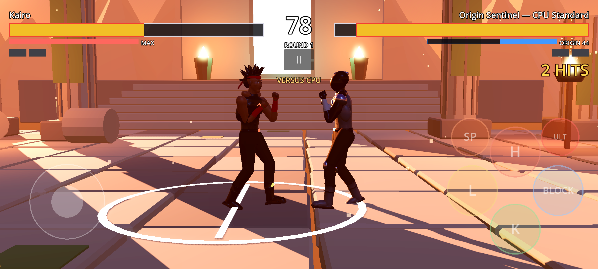
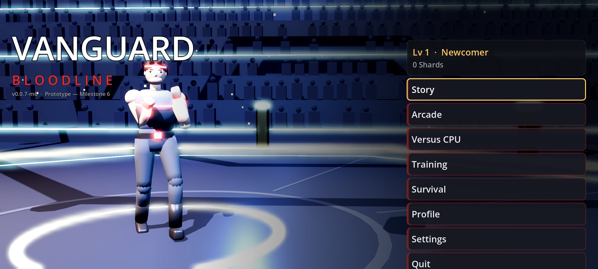

# VANGUARD: BLOODLINE

Landscape, Android-first, stylized-realistic 3D one-on-one fighting game with
2.5D combat. *Working title — needs trademark and legal review before public use.*





## Current status

| | |
|---|---|
| Version | `0.0.8-m7` |
| Milestone | **7 — UI, menus and modes** (implemented, awaiting approval) |
| Next | Milestone 8 — remaining fighters' movesets and arena polish |
| Playable | Main menu → **Story** (6 chapters, boss), **Arcade** (5-stage ladder), **Versus CPU**, **Training**, **Survival**, Profile, Settings. Kairo is playable; Drakon, Seraphina, Nox, Vexa and Ryuen are viewable in fighter select (movesets in M8). Four arenas: The Pit (Ascendant), Ryuen's Sanctuary (Temple), The Severed Line (Neon, unlockable) and The Origin Chamber (unlocked by finishing Story). Progress and settings persist. |

See [`docs/MILESTONES.md`](docs/MILESTONES.md) for the checklist and
[`docs/KNOWN_ISSUES.md`](docs/KNOWN_ISSUES.md) for open issues.

## Pinned toolchain

| Tool | Version |
|---|---|
| **Godot** | **4.7.2-stable** (standard build, *not* .NET) — do not upgrade mid-milestone |
| Language | GDScript (typed) |
| Renderer | Mobile (Vulkan) |
| Android export templates | 4.7.2-stable (must match the editor exactly) |
| 3D | Blender → glTF 2.0 `.glb` |

Unity is not used anywhere in this project.

## Setup

1. Install Godot **4.7.2-stable** from
   <https://godotengine.org/download/archive/4.7.2-stable/> (or the GitHub
   release `4.7.2-stable`).
2. Install [Git LFS](https://git-lfs.com) (`git lfs install`) — `.blend`, `.psd`
   and video sources are tracked through LFS.
3. Clone and open: `godot --path . -e` or *Import* `project.godot` in the
   Project Manager. First open imports assets into `.godot/` (git-ignored).
4. Press **F5** to run. Boot screen → main menu.

Desktop window is 1200×540; the design reference is 2400×1080 landscape and the
UI scales with `canvas_items` / `expand` stretch.

### Debug keyboard / gamepad bindings

| Action | Keyboard | Gamepad |
|---|---|---|
| Move left / right | A / D, ← / → | D-pad, left stick |
| Up (jump) / Down (crouch) | W / S, ↑ / ↓ | D-pad, left stick |
| Light / Heavy / Kick | J / K / L | X / Y / A |
| Block (hold Down for a low block) | Space | B |
| Special (Origin Palm) / toward + Special (Rift Break) | U | RB |
| Ultimate: Origin Surge at full meter, Origin Break during Surge | O | RT |
| Special / Ultimate | U / O | RB / RT |
| Pause / resume | Esc, P (or on-screen **II**, Android back) | Start |
| Debug overlay / hitboxes | F3 / F4 | — |
| Restart match (debug) | R or F5 | — |
| Cycle P2 (CPU levels / dummy modes) | T or F6 | — |

Actions are defined in `scripts/input/input_actions.gd`; bindings are generated
by `tools/configure_input_map.gd`. Up/down, special, ultimate and pause do
nothing yet.

### Touch controls (phones)

- **Left side:** touch anywhere in the lower-left area and drag to walk
  (floating stick).
- **Right side:** **L** light, **H** heavy, **K** kick, **BLOCK** (hold),
  **SP** special (hold the stick toward the opponent for Rift Break), **ULT**
  (lights up at full meter: Origin Surge, then Origin Break).
  Buttons fire on touch-down; walking and attacking work at the same time.
- **II** pauses; the pause menu toggles **left-handed** controls.
- Combo to try: **L, L, K, SP** (tap each as soon as the previous one hits;
  needs 25 meter for the Palm).

## How combat runs

- `CombatClock` turns render time into fixed **60 Hz ticks**; rendering
  interpolates between ticks. Gameplay is identical at any refresh rate.
- `CombatSimulation` (no nodes, fully deterministic) owns positions, facing,
  pushboxes, walls and max separation. Scenes only display it.
- Attacks are data: `data/moves/*.tres` (frame data, damage, hitboxes),
  collected per fighter in `data/fighters/kairo.tres`. Conventions and the
  current frame-data table: [`docs/COMBAT_FRAME_DATA.md`](docs/COMBAT_FRAME_DATA.md).
- Every hit, block, whiff and KO is logged with its tick number (on screen
  and in the console).
- Attack presses are buffered for 6 ticks; cancels and combo scaling follow
  `data/rules/combat_tuning.tres` and each move's `tags` / `cancel_tags`.
- The CPU (`AIController`) sees only what a player could see, with a
  reaction delay, and presses the same inputs a player does. Difficulty is
  data in `data/ai/`; see [`docs/AI_TUNING.md`](docs/AI_TUNING.md).
- `MatchDirector` runs rounds on top of the simulation: best of three, 90 s,
  draws award both fighters a round, hard cap of 5 rounds. Rules are data:
  `data/rules/standard_match.tres`.

## Tests

```bash
godot --headless --path . --import                       # first run only
godot --headless --path . --script res://tests/run_tests.gd
```

Exit code 0 means all tests passed. CI runs the same command on every push
(`.github/workflows/ci.yml`).

## Android

See [`docs/ANDROID_SETUP.md`](docs/ANDROID_SETUP.md). The committed
`export_presets.cfg` holds **no** signing data; keystores and passwords stay on
your machine (`.godot/export_credentials.cfg`, git-ignored).

## Repository layout

```
scenes/   app/ (boot)  menus/  combat/  fighters/  arenas/  ui/
scripts/  app/ input/ combat/ fighters/ ai/ camera/ progression/ save/ ui/
data/     fighters/ moves/ combos/ ai/ progression/   (balance data, never in code)
assets/   characters/<fighter>/ arenas/ animations/ audio/ materials/ effects/ ui/
tests/    unit/ integration/ device/
tools/    editor/headless utility scripts
docs/     specification, decisions, milestones, pipeline docs
```

## Art pipeline

The six playable fighters are the **owner's own rigged models**, converted by
`tools/blender/import_rigged.py` (look unchanged; game skeleton and animations
added; sources in `assets/characters/_source/`). Bosses and arenas are
**built from scratch by script** (Blender 5, `tools/blender/character_builder.py`,
`tools/blender/arena_builder.py` → `assets/arenas/<id>/<id>_arena.glb`); no base meshes.
Final art must follow [`docs/BLENDER_PIPELINE.md`](docs/BLENDER_PIPELINE.md);
tests check animation lengths and that strikes line up with hitboxes.

## Documentation

- [`docs/PRODUCTION_PACKAGE.md`](docs/PRODUCTION_PACKAGE.md) — **canonical specification**
- [`CLAUDE.md`](CLAUDE.md) — rules for Claude sessions in this repo
- [`docs/DECISION_LOG.md`](docs/DECISION_LOG.md) — engine, architecture, pipeline decisions
- [`docs/MILESTONES.md`](docs/MILESTONES.md) — milestone checklist
- Other `docs/*.md` files are filled in as their milestone arrives.
