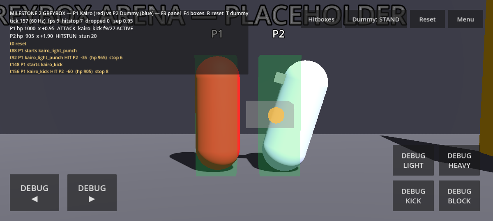

# VANGUARD: BLOODLINE

Landscape, Android-first, stylized-realistic 3D one-on-one fighting game with
2.5D combat. *Working title — needs trademark and legal review before public use.*



## Current status

| | |
|---|---|
| Version | `0.0.3-m2` |
| Milestone | **2 — attacks and hit detection** (complete, awaiting approval) |
| Next | Milestone 3 — match loop (health bars, timer, rounds, results, pause) |
| Playable | Training-style greybox: Main menu → **Fight** → walk, light/heavy/kick and block against a dummy (stand/block/jab). No rounds yet. |

See [`docs/MILESTONES.md`](docs/MILESTONES.md) for the checklist and
[`docs/KNOWN_ISSUES.md`](docs/KNOWN_ISSUES.md) for open issues.

## Pinned toolchain

| Tool | Version |
|---|---|
| **Godot** | **4.7.2-stable** (standard build, *not* .NET) — do not upgrade mid-milestone |
| Language | GDScript (typed) |
| Renderer | Mobile (Vulkan) |
| Android export templates | 4.7.2-stable (must match the editor exactly) |
| 3D | Blender → glTF 2.0 `.glb` |

Unity is not used anywhere in this project.

## Setup

1. Install Godot **4.7.2-stable** from
   <https://godotengine.org/download/archive/4.7.2-stable/> (or the GitHub
   release `4.7.2-stable`).
2. Install [Git LFS](https://git-lfs.com) (`git lfs install`) — `.blend`, `.psd`
   and video sources are tracked through LFS.
3. Clone and open: `godot --path . -e` or *Import* `project.godot` in the
   Project Manager. First open imports assets into `.godot/` (git-ignored).
4. Press **F5** to run. Boot screen → main menu.

Desktop window is 1200×540; the design reference is 2400×1080 landscape and the
UI scales with `canvas_items` / `expand` stretch.

### Debug keyboard / gamepad bindings

| Action | Keyboard | Gamepad |
|---|---|---|
| Move left / right | A / D, ← / → | D-pad, left stick |
| Up (jump) / Down (crouch) | W / S, ↑ / ↓ | D-pad, left stick |
| Light / Heavy / Kick | J / K / L | X / Y / A |
| Block | Space | B |
| Special / Ultimate | U / O | RB / RT |
| Pause | Esc, P | Start |
| Debug overlay / hitboxes | F3 / F4 | — |
| Training reset | R or F5 | — |
| Cycle dummy mode | T or F6 | — |

Actions are defined in `scripts/input/input_actions.gd`; bindings are generated
by `tools/configure_input_map.gd`. Up/down, special, ultimate and pause do
nothing yet. On a phone, use the labelled **DEBUG** buttons (temporary until
Milestone 4 touch controls) plus **Hitboxes / Dummy / Reset / Menu** at the top.

## How combat runs

- `CombatClock` turns render time into fixed **60 Hz ticks**; rendering
  interpolates between ticks. Gameplay is identical at any refresh rate.
- `CombatSimulation` (no nodes, fully deterministic) owns positions, facing,
  pushboxes, walls and max separation. Scenes only display it.
- Attacks are data: `data/moves/*.tres` (frame data, damage, hitboxes),
  collected per fighter in `data/fighters/kairo.tres`. Conventions and the
  current frame-data table: [`docs/COMBAT_FRAME_DATA.md`](docs/COMBAT_FRAME_DATA.md).
- Every hit, block, whiff and KO is logged with its tick number (on screen
  and in the console).

## Tests

```bash
godot --headless --path . --import                       # first run only
godot --headless --path . --script res://tests/run_tests.gd
```

Exit code 0 means all tests passed. CI runs the same command on every push
(`.github/workflows/ci.yml`).

## Android

See [`docs/ANDROID_SETUP.md`](docs/ANDROID_SETUP.md). The committed
`export_presets.cfg` holds **no** signing data; keystores and passwords stay on
your machine (`.godot/export_credentials.cfg`, git-ignored).

## Repository layout

```
scenes/   app/ (boot)  menus/  combat/  fighters/  arenas/  ui/
scripts/  app/ input/ combat/ fighters/ ai/ camera/ progression/ save/ ui/
data/     fighters/ moves/ combos/ ai/ progression/   (balance data, never in code)
assets/   characters/<fighter>/ arenas/ animations/ audio/ materials/ effects/ ui/
tests/    unit/ integration/ device/
tools/    editor/headless utility scripts
docs/     specification, decisions, milestones, pipeline docs
```

## Documentation

- [`docs/PRODUCTION_PACKAGE.md`](docs/PRODUCTION_PACKAGE.md) — **canonical specification**
- [`CLAUDE.md`](CLAUDE.md) — rules for Claude sessions in this repo
- [`docs/DECISION_LOG.md`](docs/DECISION_LOG.md) — engine, architecture, pipeline decisions
- [`docs/MILESTONES.md`](docs/MILESTONES.md) — milestone checklist
- Other `docs/*.md` files are filled in as their milestone arrives.
